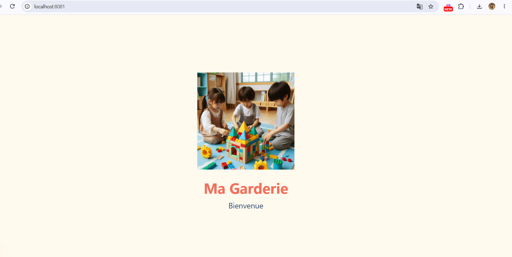
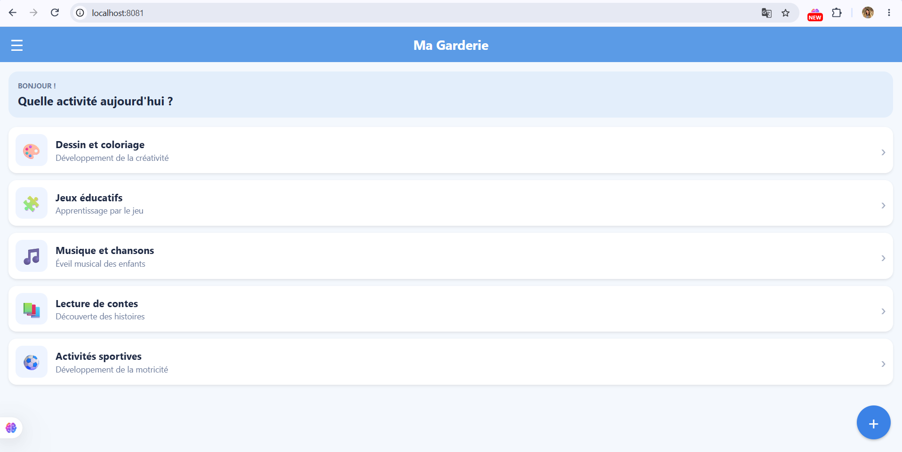
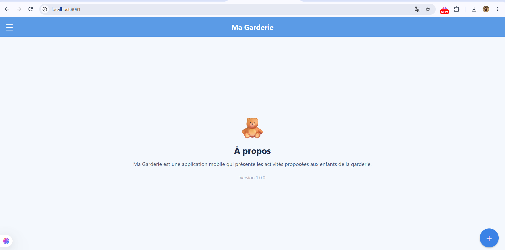
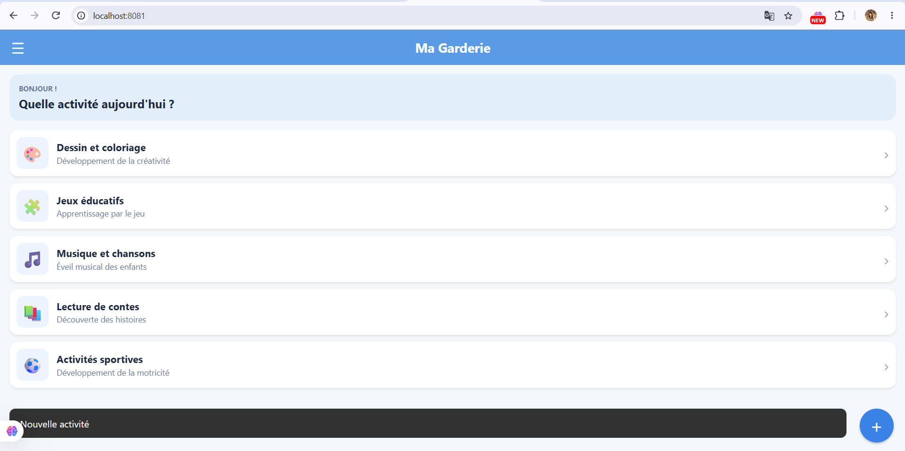

# Ma Garderie

Application mobile pour une garderie d'enfants. Elle présente les activités proposées aux enfants sous forme de liste, avec un écran de démarrage, un menu latéral (Drawer) et des interactions simples.

## Fonctionnalités

- Splash Screen avec image d'accueil, nom de l'application et transition automatique après 3 secondes
- Page principale avec une AppBar « Ma Garderie »
- Drawer avec trois entrées : Accueil, Activités, À propos
- Liste des activités (icône, titre, description) affichée avec une FlatList
- Floating Action Button `+` affichant le message « Nouvelle activité »
- Clic sur une activité : affichage de son titre dans un Snackbar

## Technologies utilisées

- React Native
- Expo
- JavaScript
- Git et GitHub

## Installation et exécution

Prérequis : Node.js (version 18 ou supérieure), Git, et l'application Expo Go sur un téléphone (ou un navigateur / émulateur Android).

```bash
git clone https://github.com/Marammaalaoui/garderie-mobile.git
cd garderie-mobile
npm install
npx expo start
```

- Scanner le QR code avec Expo Go pour lancer l'application sur un téléphone.
- Appuyer sur `a` pour un émulateur Android.
- Appuyer sur `w` pour ouvrir l'application dans un navigateur.

## Captures d'écran

### Splash Screen



### Page principale avec la liste des activités



### Drawer ouvert



### Message affiché après une interaction



## Organisation Git

Chaque étape du projet a été développée dans une branche dédiée, puis fusionnée dans `main` :

- `feature/init-project`
- `feature/splash-screen`
- `feature/home-page`
- `feature/list-view`
- `feature/interactions`
- `docs/readme`